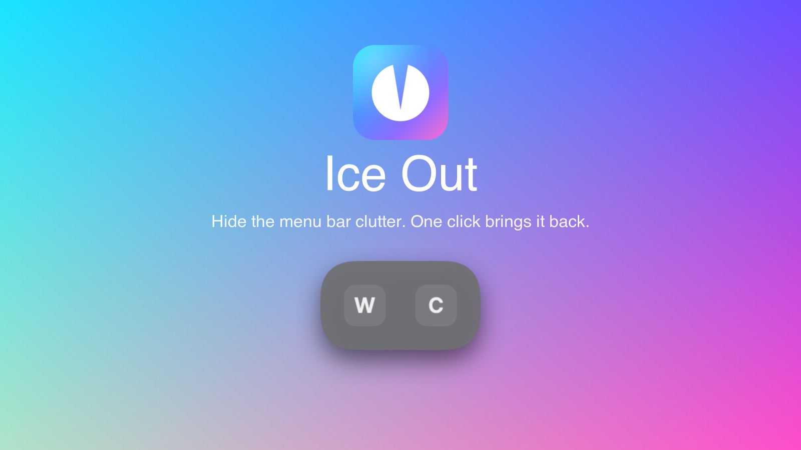
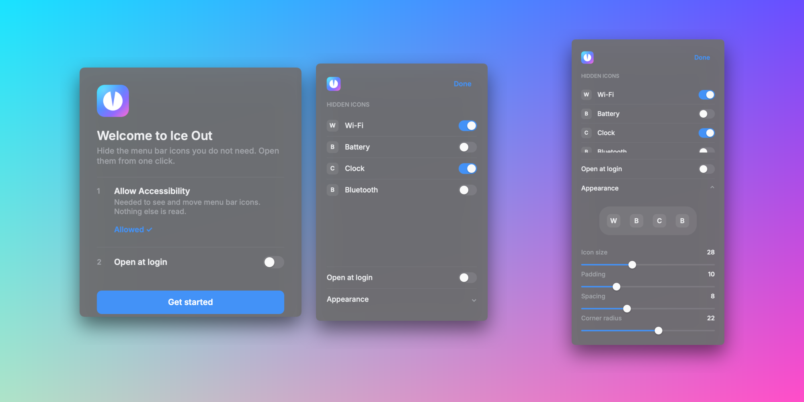
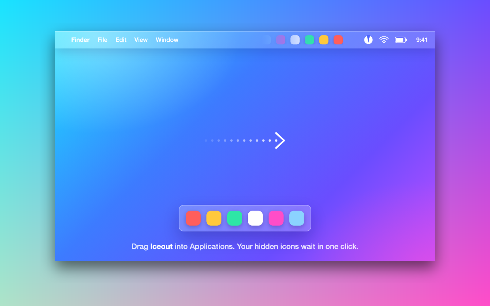

<p align="center">
  
</p>

# Ice Out

Ice Out hides the clutter in your Mac's menu bar. You pick which icons to hide. They vanish from the bar. When you want one, you click the Ice Out icon, and a small glass strip shows the hidden icons. You click one, and it opens, just like it was never hidden.

It is a small, fast app. It needs **one permission** (Accessibility). It does **not** need Screen Recording. It uses about **28 MB** of memory and **0% CPU** when you are not using it.

> Status: early (v0.1). It works and I use it, but it is young. Read [What is tested and what is not](#what-is-tested-and-what-is-not) before you trust it.

---

## The problem

Your menu bar fills up. Wi-Fi, battery, clock, then every app you install adds one more icon. On a MacBook with a notch, the bar has even less room, and macOS just quietly drops icons that do not fit. You cannot find the one you want, and you cannot get rid of the ones you do not.

Other apps solve this ([Ice](https://github.com/jordanbaird/Ice), [Bartender](https://www.macbartender.com/), [Hidden Bar](https://github.com/dwarvesf/hidden)). They are good. But two things bugged me:

1. **Permissions.** Bartender asks for Screen Recording so it can copy the picture of each icon. Ice asks for it too, and it only recently got a "limited mode" without it. macOS shows a purple "screen is being recorded" dot while they work. A menu bar tool should not need to look at your screen.
2. **Weight and feel.** I wanted something small and instant, with a window that opens in a blink and does nothing in the background.

So Ice Out asks for the smallest permission it can, and it is built to be light.

## What it does

- **Hide any icon.** Open Settings, flip a switch. The icon leaves the bar. Only that one icon moves. Nothing else flickers.
- **See hidden icons in one click.** Click the Ice Out icon. A glass strip shows your hidden icons. Click one to open it.
- **Only the icon you click shows.** The others stay hidden. When you finish with its menu, it goes back.
- **New apps show up in the list.** Install an app, and within about two seconds its icon is in Settings (hidden at first, like in Ice).
- **Tune the look.** Sliders for icon size, padding, spacing and corner radius, with a live preview.
- **Search.** Right-click the icon, then Search. Type a few letters and open any icon.
- **Keyboard shortcuts.** Hold I (for Ice) + Option + Command, then press Space to show the hidden icons or F to search. One switch in Settings, with the keys in a small line under it.
- **Presets.** Save the hidden icons under a name (Settings, then Presets). Switch from there or from the right-click menu. Only the icons that differ move.
- **Triggers.** Apply a preset on its own: on battery, plugged in, between two times, or when one of the apps you pick (any app installed on the Mac) is open. Checked every 30 seconds. No extra permission.
- **Open at login.** One switch.
- **First-launch setup.** It walks you through allowing Accessibility.
- **Quit puts everything back.** If you quit Ice Out, your bar is the way it was.

<p align="center">
  
</p>

## How it works (in plain words)

There are three tricks. None of them need Screen Recording.

**1. How icons are listed.** macOS has an Accessibility API. It lets an app, with your permission, ask other apps "what menu bar items do you have, and where are they?" That gives each icon's app name and position. Ice Out draws each app's own icon from the app itself, so it never copies pixels off your screen. The tradeoff: the list shows each app's icon, not the exact little menu bar glyph that Ice and Bartender copy with Screen Recording.

**2. How icons are hidden.** The menu bar lays icons out from the right. Ice Out adds two buttons of its own: the Ice Out icon, and an invisible "divider" to its left. To hide, the divider is made very wide (10,000 points). A very wide item pushes every icon on its left off the screen. The icons are still alive, just out of sight. No permission needed for that part.

**3. How one icon moves without a mouse.** To hide or show an icon, it has to be moved across the divider. By hand you would hold Command and drag. A first version did exactly that, and it moved your real cursor and flashed every hidden icon. That was bad.

Now it works the way Ice does it (I read [Ice's source](https://github.com/jordanbaird/Ice) to learn the method; no code was copied). Every menu bar icon is a window. The window server lists each one with an id, even off-screen ones. A drag is two mouse events. Ice Out gives each event a made-up position and tags it with the icon's window id and its owner process, then posts it. macOS does the drag on that exact window, with no real mouse travel. The cursor jumps to the drop point for a moment, so Ice Out hides it and puts it back.

Because of this, hiding, showing and "peeking" an icon move **only that icon**. The divider never has to shrink, so no other hidden icon ever shows.

## How it is made

- **Language and UI:** [Rust](https://www.rust-lang.org/) with [Rune](https://github.com/anomalyco/rune), a GPU-drawn UI framework. The windows are real Liquid Glass on macOS 26.
- **macOS parts:** [`objc2`](https://github.com/madsmtm/objc2) crates for the menu bar buttons, the right-click menu, the mouse monitors and images. Plain C calls for Accessibility and the window list.
- **No other runtime dependencies.** One binary.
- **Threads:** the main thread only draws. Reading the bar (about 40 apps) happens in parallel on background threads. Moving icons happens on its own thread, so the window never freezes.
- **Settings storage:** a tiny JSON file (`prefs.json`) written on another thread.
- **Start at login:** a launch agent file in `~/Library/LaunchAgents`.
- **Installer and icon:** drawn from code. The icon is a rounded square with a bright gradient, a white circle, and a crack cut into it, like a crack in ice.

### Project layout

| Path | What it is |
| --- | --- |
| `src/main.rs` | State, the windows (strip, Settings, welcome), reading and merging the bar |
| `src/items.rs` | Accessibility reads, the icon window list, moving icons |
| `src/status_item.rs` | The two menu bar buttons, right-click menu, window placement, peeking |
| `src/hotkeys.rs` | Keyboard shortcuts |
| `src/triggers.rs` | Triggers: the rules and the 30 second check |
| `src/presets.rs` | Presets: save, compare, work out the moves |
| `src/login.rs` | Start at login |
| `assets/` | App icon, menu bar mark, installer picture |
| `scripts/` | Builds the app, the icon and the installer |
| `docs/design.md` | Every design decision, with the reason and what was rejected |
| `docs/flow.md` | Step by step what happens, and every edge case |
| `docs/plan.md` | The research on Ice and Bartender, and the plan |

## Compared to Ice and Bartender

I did not run Ice or Bartender side by side with a profiler, so I do **not** have speed or memory numbers for them, and I will not make any up. What I can say honestly comes from their own docs and screenshots:

| | Ice Out | [Ice](https://github.com/jordanbaird/Ice) | [Bartender](https://www.macbartender.com/) |
| --- | --- | --- | --- |
| Price | Free | Free, GPL-3.0 | Paid (trial first) |
| Source | Open | Open | Closed |
| Permissions | Accessibility only | Accessibility, and Screen Recording (a limited mode without it) | Accessibility and Screen Recording |
| Shows exact menu bar glyphs | No, shows app icons | Yes | Yes |
| Purple screen-recording dot | Never | When capture is on | When capture is on |
| Hides icons | Yes | Yes | Yes |
| Shows only the clicked icon | Yes | Yes (temp show) | Yes |
| Search and hotkeys | Yes (fixed keys) | Yes | Yes |
| Presets | Yes | No | Yes |
| Triggers | Battery, time, app (no Wi-Fi, Focus yet) | No | Yes |
| Menu bar styling (tint, border, shape) | No | Yes | Yes |
| Notch handling | Basic (moves unseen icons to the hidden side) | Yes (Ice Bar) | Yes |

**Where Ice Out is different:** the permission story, and the size. **Where it is behind:** Ice and Bartender have far more features, and they show the real glyphs. If you need search, hotkeys, triggers or styling, use them.

## Speed and memory (measured)

Release build, one MacBook with a notch, macOS 26. These are my own numbers for Ice Out.

| What | Result |
| --- | --- |
| Memory when idle (`phys_footprint`) | 28 MB (RSS about 60 MB, which counts shared system libraries) |
| Memory with the window open | about 32 MB |
| Memory after 60 open and close cycles | 36 to 40 MB, settles back to 37 MB, no leak trend |
| CPU when idle | 0% |
| Menu bar buttons appear after launch | about 90 ms |
| Bar read and hidden icons hidden after launch | about 295 ms (was about 1090 ms before the startup fix) |
| Window opens after a click | 33 to 40 ms |
| Reading the whole bar (about 40 apps) | about 100 to 175 ms, on a background thread (was 2.5 s on the main thread) |
| Binary size | about 17 MB |

Things that were slow, and what fixed them (all in `docs/design.md`):

- The first read waited a fixed second. Now it waits for its own buttons (1090 ms to 295 ms).
- One slow helper app made the whole read take 2.5 s and froze the window. Now every app is asked in parallel with a short wait.
- A drag with the real mouse flashed every icon. Now icons move with window-targeted events, one at a time.

## What is tested and what is not

I tested these live on a real menu bar, with screenshots:

- Hide and unhide an icon from Settings.
- Click a hidden icon in the strip: only that icon shows, its menu opens, and it goes back.
- A new app's icon appears in the list within seconds, and leaves it when the app quits.
- Click away closes the window. Quit brings every icon back.
- The first-launch setup and the "Open at login" switch file.
- The cursor stays where it was during moves.
- Memory stays flat over many open and close cycles.

Built, but **not tested live yet** (please try them and tell me):

- Triggers: the form, and a trigger firing on its own. I only tested that the time, power and app checks answer, and how the screens look.
- Presets: saving one, applying one (moves several icons) and deleting one. I only checked that the window opens from Settings and that the moves are worked out right (unit tests).
- Search with a real click, and the two keyboard shortcuts (the keyboard tap is created and active, but I did not press the keys, because key presses stop my own session).
- The window opening under the right display on a **second monitor**.
- An app that restarts getting its icon put back where you had it.
- Icons that macOS cannot fit under the **notch** being moved to the hidden side.
- "Open at login" across a real logout.
- A slow app's icon staying in the list for a moment instead of flickering.

## Still in development

- Choose your own hotkeys.
- Triggers for Wi-Fi and Focus (they need extra permissions, so they would be opt-in), and more than one condition per trigger.
- Always-hidden section.
- Real menu bar glyphs as an optional extra (this needs Screen Recording, so it would be opt-in).
- Developer ID signing and notarization, so other Macs open it without a warning.
- Light mode checks and more screens.

## Known limits

- **System icons** (Wi-Fi, Battery, Clock, Control Centre, Search) are left out of the list on purpose. They belong to macOS, and macOS does not let you move all of them.
- **New icons start hidden**, because macOS puts new icons at the far left, which is the hidden side. This is how Ice works too.
- **First run after a new build:** a new build is a new app to macOS. Allow Accessibility again, and hide your icons once more.
- Icons that macOS controls itself (the camera and microphone dots) cannot be moved.

## Install

1. Open `Ice Out.dmg`.
2. Drag **Ice Out** into **Applications**.
3. Open it. Follow the welcome window and allow Accessibility.

<p align="center">
  
</p>

The app is signed ad hoc for now. On another Mac, macOS will ask you to confirm you want to open it.

### Build it yourself

You need a Mac on macOS 14 or later, [Rust](https://rustup.rs/), the Xcode command line tools, and Google Chrome (only used to draw the installer picture).

```bash
git clone https://github.com/dishant0406/ice-out.git
cd ice-out
cargo run --release          # run it from the terminal
./scripts/package.sh         # build dist/Iceout.app and dist/Iceout.dmg
```

Check the screens without a display:

```bash
cargo run -- --snap out/settings.png --scene settings --size 320x480 --scale 2
```

See how long startup takes:

```bash
ICEOUT_TRACE=1 ./target/release/iceout
```

## Privacy

Ice Out reads the names and positions of menu bar items through Accessibility. It never looks at your screen, never reads what is inside other apps, and never sends anything anywhere. It has no network code. Your settings stay in one small file on your Mac.

## Credits

- [Ice](https://github.com/jordanbaird/Ice) by Jordan Baird: I studied how it moves menu bar icons. Ice is GPL-3.0. Ice Out contains none of its code, only the same idea, written again.
- [Rune](https://github.com/anomalyco/rune): the UI framework.
- [Hidden Bar](https://github.com/dwarvesf/hidden): the wide-divider idea.

## License

Not chosen yet.
